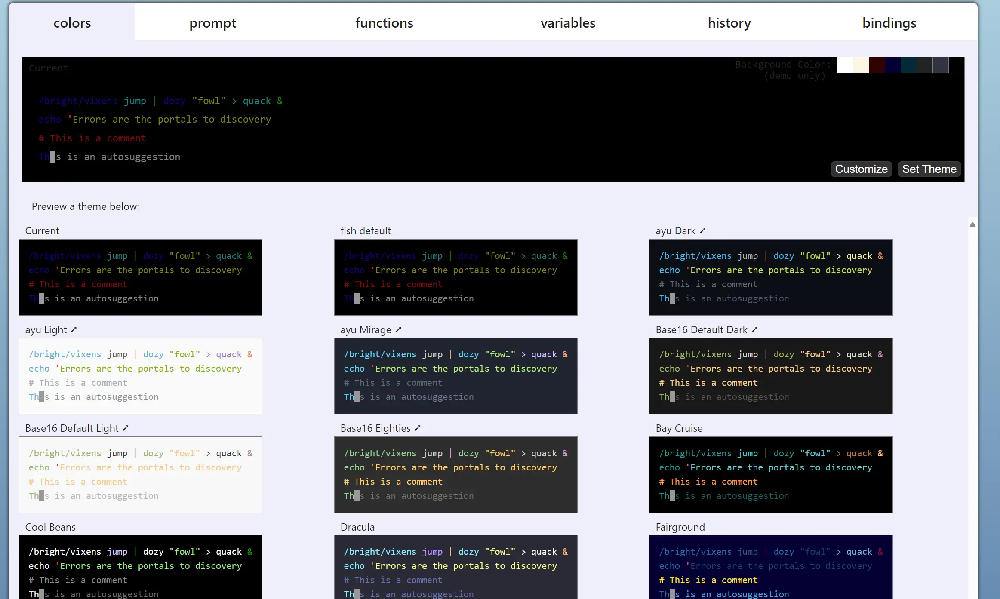

# Fish Shell 的安装与基本配置

> Finally, a command line shell for the 90s

Fish Shell 是一款智能且用户友好的命令行界面，适用于 Linux、macOS 及其他类 Unix 系统。它以提高用户效率和改善命令行使用体验为目标，通过高级特性如自动建议、语法高亮和易于理解的脚本语言来实现这一点。

之前一直使用`oh-my-zsh`，这个项目还是很棒的，不过这个项目越来越庞大导致现在启动有点慢了。我在网上看到有人也推荐`zim`，不过我去了解一下还是放弃了，这个项目目前名叫[zimfw](https://github.com/zimfw/zimfw)不过是个新开的项目，因为之前的项目删库了。有点担心新项目未来也删库，索性直接用上已经被安利了很久的 FISH。

::: tip 关于版本

fish 目前最新稳定版为 **4.x**（4.0 发布于 2025-02-27，主要变化见文末「fish 4.0 有什么变化」）。

系统软件源里的版本往往偏旧，例如 Ubuntu 24.04 官方源仍是 3.7.0，想要 4.x 请使用官方 PPA。

:::

## 安装 Fish Shell

### 1. 各系统安装

**Ubuntu / Debian**

多数发行版官方源已自带 fish，直接安装即可：

```sh
sudo apt update
sudo apt install fish
```

若发行版是 Ubuntu 24.04 及更早版本，官方源里还是 fish 3.x。想用上 fish 4.x，添加官方 PPA：

```sh
sudo apt-add-repository ppa:fish-shell/release-4
sudo apt update
sudo apt install fish
```

> Debian 用户没有 PPA 可用，可等待官方源更新，或参考官网自行编译。

**macOS**

```sh
brew install fish
```

**其他系统**：访问[官方文档](https://fishshell.com/docs/current/index.html#installation)获取更多安装指南。

### 2. 免 root 的静态二进制（可选）

fish 4.0 起支持「自解压」的静态二进制，无需 root、无需配置软件源，拷过去就能用，特别适合没有安装权限的服务器：

```sh
# x86_64 / aarch64 按需替换
curl -LO https://github.com/fish-shell/fish-shell/releases/download/4.9.3/fish-4.9.3-linux-x86_64.tar.xz
tar -xf fish-4.9.3-linux-x86_64.tar.xz
./fish --version
```

首次运行会把函数、man 手册等释放到家目录。

### 3. 设为默认 shell

```sh
# 1. 先把 fish 加入 /etc/shells（官方推荐做法）
command -v fish | sudo tee -a /etc/shells

# 2. 再把默认 shell 换成 fish
chsh -s "$(command -v fish)"
```

重新登录（关闭终端重新打开，或退出 SSH 重新连接）即可生效，**不需要 reboot**。

::: tip 提示

不建议像早期那样写死 `/usr/bin/fish`：fish 并不总装在 `/usr/bin`（静态二进制方式可能在 `~/.local/bin`），用 `command -v fish` 更稳妥。

:::

::: tip 提示

若总是报错 `chsh: PAM: Authentication failure`，可以改用 `usermod` 修改（不建议手动编辑 `/etc/passwd`，格式写错会导致无法登录）：

```sh
sudo usermod -s "$(command -v fish)" "$USER"
```

查看系统当前使用的 shell：

```fish
echo $SHELL
```

输出 `/usr/bin/fish`（或你的实际安装路径）就表明已经将 fish 设置为默认 shell。

:::

可视化配置：`fish_config`


::: tip 提示

如果是连接的远程服务器可能无法打开，这个时候可以在本地配置好后把`prompt`复制到远程服务器上
`~/.config/fish/functions/fish_prompt.fish`
:::

### 4. 个性化

配置 nano 的 tab 为现在更常见的 4 空格

```fish
nano ~/.nanorc

# .nanorc
set tabsize 4
```

配置 alias 在 Fish shell 中，你可以通过创建一个名为 rm 的函数来模拟 rm -i 的行为。这样，每次你运行 rm 时，它都会以交互模式运行，提示你确认是否真的要删除文件。

```fish
nano ~/.config/fish/config.fish

# .config/fish/config.fish
if status is-interactive
    # Commands to run in interactive sessions can go here
    function rm
        command rm -i $argv
    end
end
```

## 常用工具

fish 自带的功能已经很多（自动建议、语法高亮都是内置的，`sudo` 的快捷键是 `ALT+s`），所以额外要装的东西不多。下面两个是我现在在用的，都是**通过官方方式直接安装**，不再依赖插件管理器。

### zoxide —— 目录快速跳转

早期我用的是 `z` 插件，后来换成了 [zoxide](https://github.com/ajeetdsouza/zoxide)。它同样是「记录常去目录、按关键词跳转」的思路，但本身是一个独立的可执行文件，不绑定任何 shell，在 bash、zsh、fish 下都能用，换 shell 也不用换工具。

**安装**

```sh
# 官方推荐：安装脚本
curl -sSfL https://raw.githubusercontent.com/ajeetdsouza/zoxide/main/install.sh | sh

# 也可以用包管理器
sudo apt install zoxide
# brew install zoxide
# cargo install zoxide --locked
```

**在 fish 中启用**

在 `~/.config/fish/config.fish` 的**末尾**加上一行即可（zoxide 会自己注入 `z`、`zi` 命令和目录记录钩子）：

```fish
zoxide init fish | source
```

**常用命令**

```fish
z foo          # 跳转到匹配度最高的 foo 目录
z foo bar      # 同时匹配 foo 和 bar
z ~/foo        # 和普通 cd 一样用
zi foo         # 配合 fzf 交互式选择（需要额外安装 fzf）
```

::: tip 从 z 插件迁移旧数据

原来用 `z` 插件积累的目录记录可以直接导入，不用重新养：

```fish
zoxide import z
```

:::

### fnm —— Node 版本管理

Node 版本管理我用的是 [fnm](https://github.com/Schniz/fnm)（Fast Node Manager）。它用 Rust 写成、单文件安装、启动很快，并且原生支持 `.nvmrc` 和 `.node-version`，可以直接接手已有项目。

**安装**

```sh
# 官方安装脚本（会自动往 fish 的 conf.d 里写入加载语句）
curl -fsSL https://fnm.vercel.app/install | bash

# 或者
brew install fnm
```

**在 fish 中启用**

如果安装脚本没有自动写入，手动创建 `~/.config/fish/conf.d/fnm.fish`，内容为：

```fish
fnm env --use-on-cd --shell fish | source
```

其中 `--use-on-cd` 表示进入带有 `.nvmrc` / `.node-version` 的目录时自动切换版本，这是 fnm 最实用的特性之一。

**常用命令**

```fish
fnm list                  # 查看本地已安装的版本
fnm install --lts         # 安装最新的 LTS 版本
fnm use lts-latest        # 切换版本
fnm default lts-latest    # 设为默认版本（新终端自动使用）
fnm current               # 查看当前版本
```

::: tip 项目级锁定版本

在项目根目录生成版本文件，配合 `--use-on-cd` 就能实现「进入目录自动切版本」：

```fish
node --version > .node-version
```

:::

### 为什么现在不装 Fisher 了

早期这篇文章推荐过 [Fisher](https://github.com/jorgebucaran/fisher) 作为 fish 的插件管理器，现在我不再建议这么做了，原因主要有三点：

1. **它会往你的配置目录里写文件。** Fisher 安装插件的方式是把插件文件直接展开复制到 `~/.config/fish/`，其官方 README 也明确提示「**默认会覆盖同名文件**」。这样一来第三方文件和自己的配置混在一起，出问题不好定位，自己改过的东西也可能在更新插件时被覆盖掉。
2. **鱼本身够用，工具也都有官方集成。** fish 4.x 自带自动建议、语法高亮、补全和历史搜索；而 zoxide、fnm 这类工具都提供了官方的 fish 支持（`zoxide init fish`、`fnm env --shell fish`），把一行初始化语句写进 `config.fish` 或 `conf.d/` 就完事了，中间不需要再夹一层包管理器。
3. **少一层依赖更透明。** 直接用官方安装方式，升级、卸载、排查问题都按工具自己的文档来，路径和文件归属清晰，启动也少一次插件加载。

所以现在的做法是：**需要什么工具就装什么工具，各自用官方方式接入 fish**，不再统一交给插件管理器。

## fish 4.0 有什么变化

fish 4.0 是一次大版本更新，工程量最大的改动是**整个项目从 C++ 重写为 Rust**（对使用者基本无感知）。除此之外还有一些实用变化：

- **按键绑定更易读**：`bind` 支持按键表示法，原来要写 `bind \e\[1\;5C`，现在可以直接写 `bind ctrl-right`、`bind alt-backspace`。
- **更好的组合键识别**：默认启用 kitty 键盘协议等终端特性，可以区分 `ctrl-i`、`ctrl-I` 和 `Tab`。若终端里出现 `5u`、`=0` 之类的奇怪字符，通常是终端自身的问题，可临时关闭：

  ```fish
  set -Ua fish_features no-keyboard-protocols
  ```

- **命令级缩写**：缩写可以只在特定命令下生效，例如 `abbr --command git co checkout`，比 git 自带的 alias 更灵活。
- **默认配色调整**：命令不再渲染为蓝色。老用户想换上新配色，执行 `fish_config` 重新加载主题即可。
- **静态二进制安装**：见上文「免 root 的静态二进制」。
- **历史记录过滤**：可以定义 `fish_should_add_to_history` 函数，自行决定哪些命令不写入历史。

完整内容见[官方 4.0 发布说明](https://fishshell.com/docs/4.0/relnotes.html)与[官方博客](https://fishshell.com/blog/new-in-40/)。

## 结语

Fish Shell 配合这些各司其职的工具，可以在保持配置简单透明的同时，极大地提升命令行的使用体验和效率。
